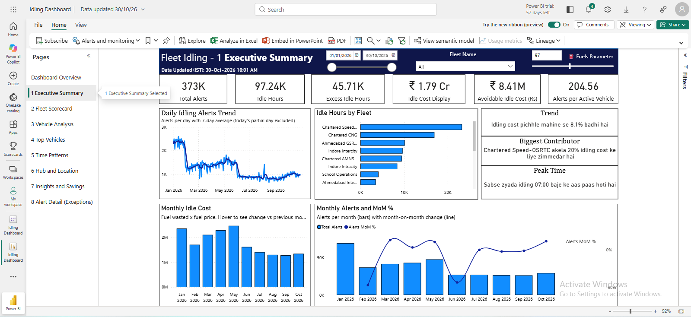
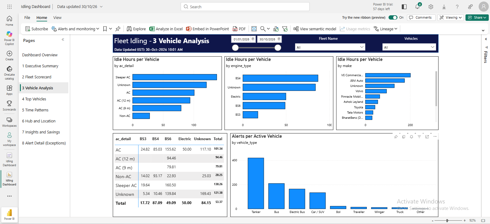
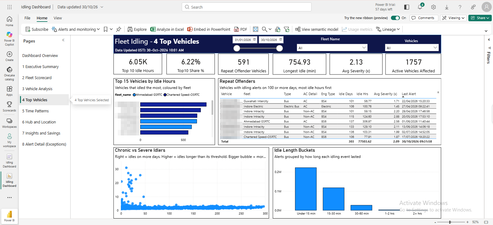
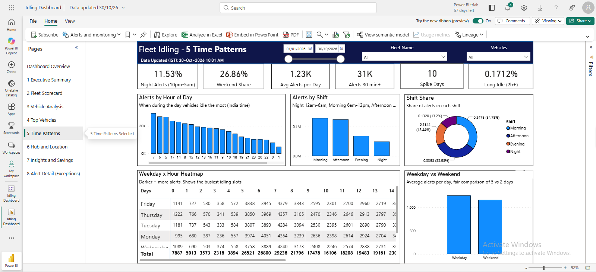
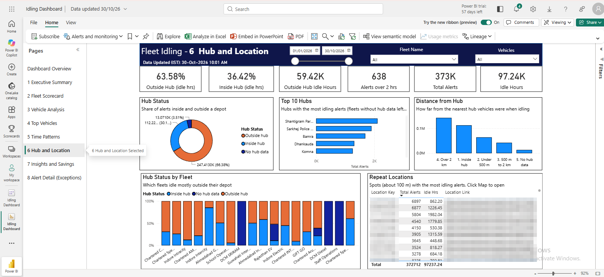
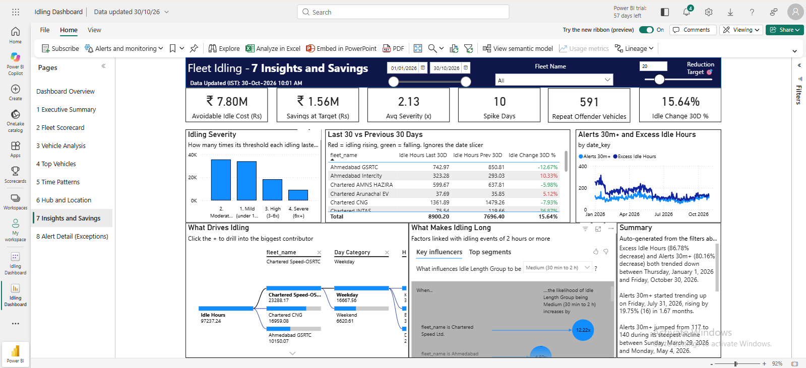
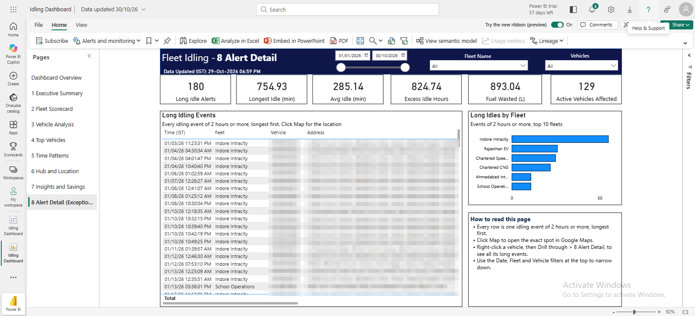

# Fleet Idling & Fuel Efficiency Analytics (Power BI)

End-to-end analytics for bus fleet idling: **Intangles API → Python → SQL Server (Bronze/Silver/Gold) → Power BI**.

The dashboard shows where, when and how much vehicles idle, what it costs in fuel, and how much of it is avoidable.

> Note: All screenshots use anonymised data. Vehicle plates, addresses and company identifiers are blurred or removed.

## Problem

Fleet operators lose a large amount of fuel to idling, but raw alert logs do not show patterns. Thresholds also differ by fleet (5 to 30 minutes), so raw alert counts cannot be compared fairly. This project turns daily idling alerts into decisions: which fleets, vehicles, hours and locations to act on first.

## Architecture

```
Intangles Alert-Logs API
        │  (Python, 3-day windows, retry on 429/5xx)
        ▼
 Bronze  → raw rows + raw JSON, batch id
        ▼
 Silver  → MERGE on alert_id (no duplicates), UTC → IST, hub fields
        ▼
 Gold    → daily / vehicle / hub / hourly summaries
        ▼
 Power BI (reads Silver, star schema)
```

Scheduled daily with Windows Task Scheduler.

## Tech Stack

Python · SQL Server Express · T-SQL stored procedures · Power BI · DAX · Windows Task Scheduler

## Dashboard Pages

| # | Page | Question it answers |
|---|------|---------------------|
| 1 | Executive Summary | How big is the problem, and is it improving? |
| 2 | Fleet Scorecard | Which fleets are worst, compared fairly? |
| 3 | Vehicle Analysis | Do AC type, engine type, make or vehicle type change idling? |
| 4 | Top Vehicles | Which vehicles idle most, and how often? |
| 5 | Time Patterns | When does idling happen (hour, shift, weekday)? |
| 6 | Hub and Location | Inside or outside depots, and where? |
| 7 | Insights and Savings | What is avoidable, and what would a reduction save? |
| 8 | Alert Detail | Which are the longest idling events? |

Screenshots are in [`screenshots/`](screenshots/). Vehicle plates, addresses and coordinates are pixelated.

### Executive Summary


### Vehicle Analysis


### Top Vehicles


### Time Patterns


### Hub and Location


### Insights and Savings


### Alert Detail


## Key Features

- **Incremental load** with a per-fleet watermark and a 24-hour overlap so late alerts are not missed
- **Backfill mode** (`--from-date`, `--to-date`) without touching the watermark
- **Resilient API calls**: throttling and 6 retries with growing waits
- **Idempotent Silver layer** (MERGE on `alert_id`)
- **Fair comparison metrics**: Excess Idle Hours, Avg Severity (x), per-vehicle measures
- **What-if sliders** for fuel price and reduction target
- **Auto-generated insights** (trend, biggest contributor, peak time)
- **Decomposition tree, Key influencers and Smart narrative** for root-cause exploration

## Data Model

Star schema: `silver_idling_alerts` (fact) with `dim_date`, `dim_fleet`, `dim_vehicle`.
`dim_fleet` and `dim_vehicle` are linked in DAX with `TREATAS`, not with a relationship.

## Challenges and Fixes

| Problem | Fix |
|---|---|
| API rate limit (HTTP 429) | Throttle + retries with growing waits |
| Scheduler failed due to spaces in path | Run through `cmd.exe /c` with Start in set |
| Late alerts missed | 24-hour overlap + MERGE |
| Alert counts fell after thresholds were raised | Use Excess Idle Hours and Alerts 30m+ for trends |
| Savings larger than avoidable cost | Savings now based on Avoidable Idle Cost |
| EV fuel values unreliable | Electric vehicles excluded from fuel and cost |

## Known Limits

- Only idling above the fleet threshold is recorded
- Alert counts are not comparable across fleets with different thresholds
- Hub data is missing for some fleets
- Engine hours are not available, so "Idling % of engine hours" cannot be calculated

## Repository Structure

```
├── README.md
├── screenshots/
├── etl/            idling_etl.py, load_vehicle_master.py, run_idling_etl.bat
├── sql/            01_create_tables.sql (+ stored procedures)
└── docs/           Full build documentation
```

## How to Run

1. Create the database and tables with `sql/01_create_tables.sql`.
2. Set the API token as an environment variable (never commit it):
   `setx INTANGLES_TOKEN "your-token"`
3. Backfill history: `python etl/idling_etl.py --from-date 2026-01-01 --to-date 2026-01-31`
4. Schedule `run_idling_etl.bat` daily in Task Scheduler.
5. Load the vehicle master: `python etl/load_vehicle_master.py` (use your own file).
6. Open the Power BI report and point it to your SQL Server.

## Author

**Motilal Jangid** · [LinkedIn](https://www.linkedin.com/in/motilal-jangid/) · motilalj817@gmail.com
